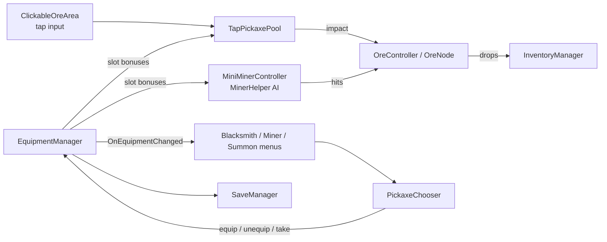

# [Game Title]

> A 2D pixel-art idle tycoon about mining ore, hiring miners, and collecting pickaxes.
> Built solo in Unity (C#). **Status: in active development.**

<!-- TODO: replace with a 5-10 second GIF of the core loop (tap -> pickaxe flies -> ore breaks -> drops collected). This is the single most important thing in the README. -->


<!-- TODO: add 3-4 screenshots: the field, the miner menu, the pickaxe chooser, the summon screen. -->

| Field | Miners | Pickaxe chooser | Summons |
|---|---|---|---|
|  |  |  |  |

**Role:** solo developer (design, code, UI, audio tooling)  
**Engine:** Unity [version] · C# · DOTween  
**Platform:** [mobile portrait / PC]  
**Play it:** [link to a build or itch.io page, if any]

---

## The game

You start by tapping ore nodes to break them and collect resources. Money buys upgrades, unlocks new ore fields, and hires miners who work the field on their own. Pickaxes are collected from summons (with rarities and stars) and can be equipped by the player or by individual miners, each giving different bonuses.

### Features

- **Tap mining:** every tap throws a pickaxe that flies to the nearest ore and deals damage on impact (crits included).
- **Auto miners:** each ore field can hire several miners. They pick a spot around an ore, face it, and hit it with fists or a pickaxe swing.
- **Equipment system:** pickaxes have rarity, stars, and stat bonuses. The player and every miner have their own slot.
- **Summons:** a gacha-style pull system with rarity odds and a reveal animation.
- **Upgrades:** tap damage, crit chance, crit damage, miner damage, miner speed, miner slots, ore field capacity and spawn rate.
- **Save system:** equipment, miner slots, and progression persist between sessions.
- **Procedural audio:** all sound effects and music were generated with scripts in [`tools/audio`](tools/audio) (see below).

---

## Technical highlights

These are the parts I would like a reviewer to look at. Paths are relative to `Assets/Scripts/` <!-- TODO: confirm the folders -->.

### Equipment and slots

`EquipmentManager`, `EquipmentItem`, `PickaxeChooser`

- Items are small structs (data + stars) used as dictionary keys, so ownership is a count per item instead of a list of object instances.
- Equipment is tracked as **slots** (`"Player"`, and one slot per miner built from the ore's ID). The same `Equip` / `Unequip` / "take from another user" logic serves the player and all miners.
- "Free copies" are derived (`owned - users`), not stored, so the state can't drift out of sync.
- Save data was extended with an additive field, with validation on load: if a saved slot references an item the player no longer owns, it is emptied with a warning instead of crashing.
- One shared chooser UI is reused by the Blacksmith (player), Miner, and Summon menus. It pools its grid cells, keeps a selection that survives refreshes, and offers a single context-sensitive action (**Equip**, **Unequip**, or **Take**) depending on the selected cell.

### Miner AI and animation

`MinerHelper`, `MiniMinerController`

- Miners choose a spot on a ring around an ore (inside an outer radius, outside an inner one) on the side facing the field's centre. A personal-space check uses squared 2D distance and falls back to the *least crowded* candidate after a number of attempts, so miners spread out instead of stacking.
- Limbs are separate sprites animated with **DOTween sequences that are built once and replayed**, with distinct animations for a fist punch and a pickaxe swing. Facing flips the visual and swaps the head sprite (front/back).
- Targets are validated against the field's active-node list, because a disabled parent root doesn't flip `activeSelf` on the child. This fixed miners attacking ores that had already broken.
- Stat formulas combine base values with equipment bonuses: damage and speed use `(base + flat) * (1 + percent / 100)`; crit stats use only flat bonuses.

### Tap pickaxe projectile

`TapPickaxePool`, `ClickableOreArea`, `OreController`

- A single **global pool with a ring buffer** (no searching for a free item, and tap spam recycles the oldest projectile).
- The pickaxe flies to the nearest ore, deals damage **on impact**, and falls if the ore breaks mid-flight or none is left. The check runs only over the pool, with no per-frame allocation.
- Input was moved from per-frame polling in the ore controller to a UI `IPointerClickHandler`, which respects UI layering and costs nothing between taps.

### Performance habits

- Pooling for ore nodes, resource drops, damage numbers, tap pickaxes, and grid cells.
- Squared-distance comparisons, cached IDs and lookups, and no LINQ or closures in per-frame code.
- Event-driven UI refresh (`GameEvents.OnEquipmentChanged`, inventory events) instead of polling.
- A small audio voice pool with per-play pitch variation, so frequent sounds don't pile up.

### Audio tooling

[`tools/audio`](tools/audio) <!-- TODO: add the scripts to the repo -->

- Sound effects (pickaxe hits, ore break, UI clicks, etc.) and music loops are synthesized with Python (NumPy/SciPy) and exported as WAV/OGG.
- Music loops are rendered with **wrap-around tails and circular convolution reverb**, so the loop point has no click or gap.

---

## Architecture at a glance



---

## Getting started

```bash
git clone [repo url]
```

1. Open the project in Unity **[version]**.
2. Open the scene `Assets/Scenes/[Main].unity`.
3. Press Play. <!-- TODO: any required packages or setup, e.g. DOTween (free) import -->

**Dependencies:** [DOTween](http://dotween.demigiant.com/) <!-- TODO: add any others (TextMeshPro, Input System, ...) -->

---

## Project structure

```
Assets/
  Scripts/
    ...            <!-- TODO: a short tree of the main folders -->
  Scenes/
  Sprites/
tools/
  audio/           synthesis scripts for SFX and music
docs/              design notes and media
```

---

## Roadmap

- [x] Tap and miner mining loop, with crits
- [x] Equipment: rarities, stars, player and miner slots, preview and chooser UI
- [x] Save and load for progression and equipment
- [x] First pass of sound effects and music
- [ ] Pull costs and currencies for summons
- [ ] Pity system and star-up/merging rules
- [ ] Shop: limited crate, bazaar, field costs
- [ ] More ore fields and polish for miner animation

---

## What I learned

<!-- TODO: 3-4 honest bullet points in your own words. Examples to adapt:
- Why you moved from polling input to events.
- A bug that taught you something (e.g. the activeSelf vs activeInHierarchy issue for miners).
- A design decision you changed after playing it.
Reviewers read this section more than you'd expect. -->

---

## Contact

[Your name] · [email] · [LinkedIn] · [portfolio]
